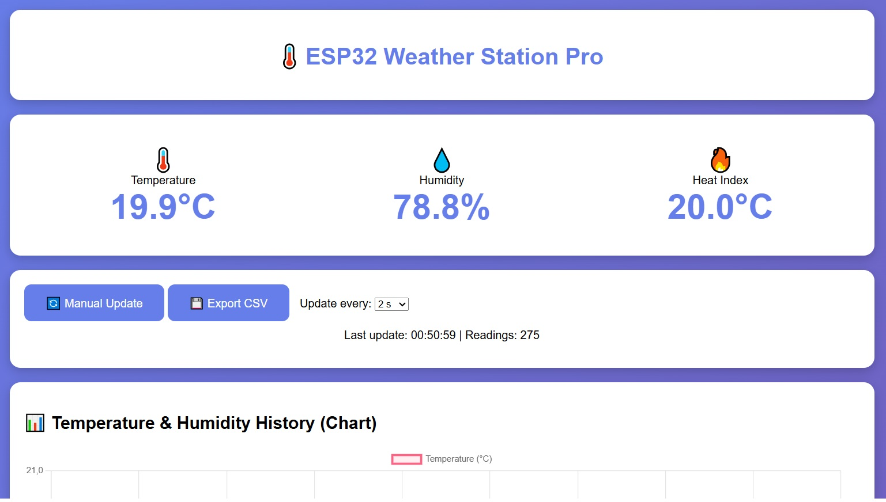

# ESP32 Weather Station Pro

A small weather station on ESP32 + DHT22. The ESP32 hosts a web dashboard on your local network: live temperature, humidity and heat index, charts, a table of recent measurements, and CSV export.



## Features

- Live temperature, humidity and heat index
- Auto-updating charts (Chart.js)
- Table of measurements for the last hour
- History of the last 300 measurements stored in RAM
- CSV export of the whole history
- Adjustable update interval (2–60 s) from the web page
- Sensor error filtering (NaN and out-of-range values are discarded)

## Hardware

- ESP32 development board
- DHT22 (AM2302) sensor
- 10 kΩ pull-up resistor between VCC and DATA (not needed if your DHT22 is on a breakout board that already has one)
- Breadboard and jumper wires

### Wiring

| DHT22 pin | ESP32 |
|-----------|-------|
| VCC       | 3.3V  |
| DATA      | GPIO 15 |
| GND       | GND   |

The pin can be changed with `DHTPIN` in the sketch.

## Software requirements

- Arduino IDE with the [Arduino-ESP32](https://github.com/espressif/arduino-esp32) board package
- Libraries (Library Manager):
  - **DHT sensor library** by Adafruit
  - **Adafruit Unified Sensor**
- `WiFi` and `WebServer` are included with the ESP32 core

## Setup

1. Clone the repository and open `weather-station.ino`.
2. Enter your Wi-Fi credentials at the top of the sketch:
   ```cpp
   #define WIFI_SSID     "your_ssid"
   #define WIFI_PASSWORD "your_password"
   ```
3. Select your ESP32 board and port, then upload the sketch.
4. Open the Serial Monitor at **115200 baud** and wait for the line `IP address: x.x.x.x`.
5. Open that IP address in a browser on the same network.

## HTTP endpoints

| Endpoint | Description |
|----------|-------------|
| `/` | Web dashboard |
| `/data` | Current values as JSON (temperature, humidity, heatIndex, readings, uptime) |
| `/history` | Measurement history as JSON |
| `/export` | History as a CSV file (`weather.csv`) |
| `/setInterval?ms=5000` | Set measurement interval in ms (2000–60000) |

## Notes and limitations

- The DHT22 cannot be polled more often than once every 2 seconds, hence the 2 s minimum interval.
- History is kept in RAM and is lost on reboot. Timestamps are time since boot, not real time.
- The dashboard loads Chart.js from a CDN, so the **browser** needs internet access (the ESP32 itself does not).
- The heat index is only meaningful at higher temperatures (roughly above 26 °C).
- Opening the dashboard resets the measurement interval to the value selected on the page.
- There is no authentication. Use it only on a trusted local network and do not expose it to the internet.

## Project structure

```
weather-station/
├── weather-station.ino
├── README.md
├── LICENSE
└── screenshot.jpg
```

## License

MIT
